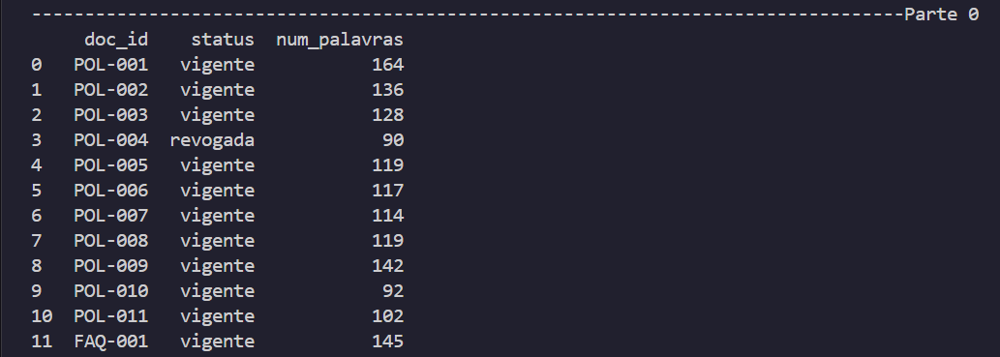
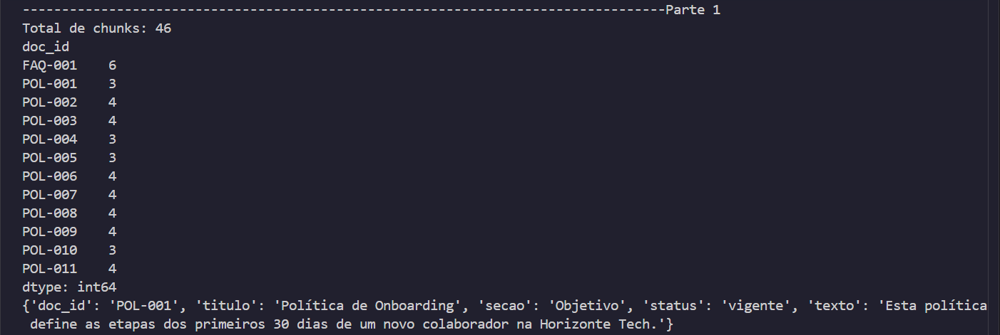
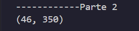
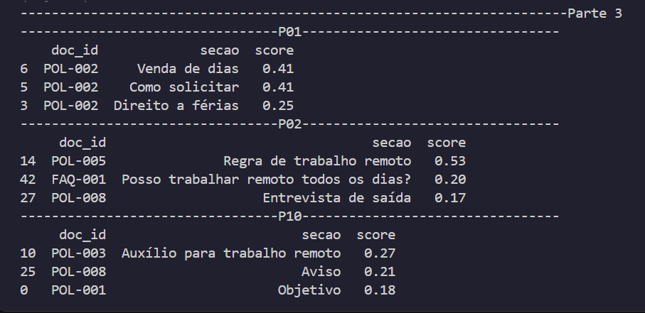
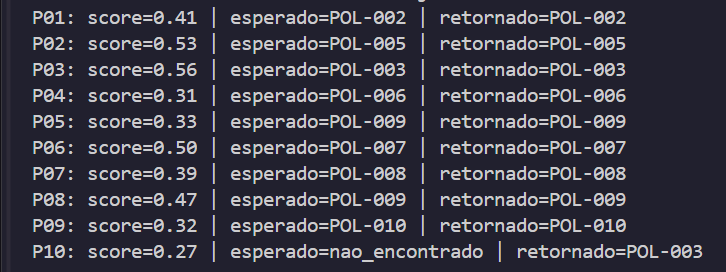
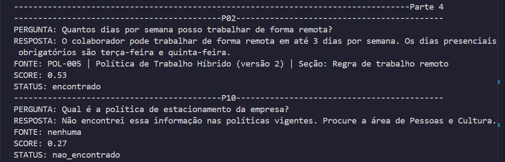
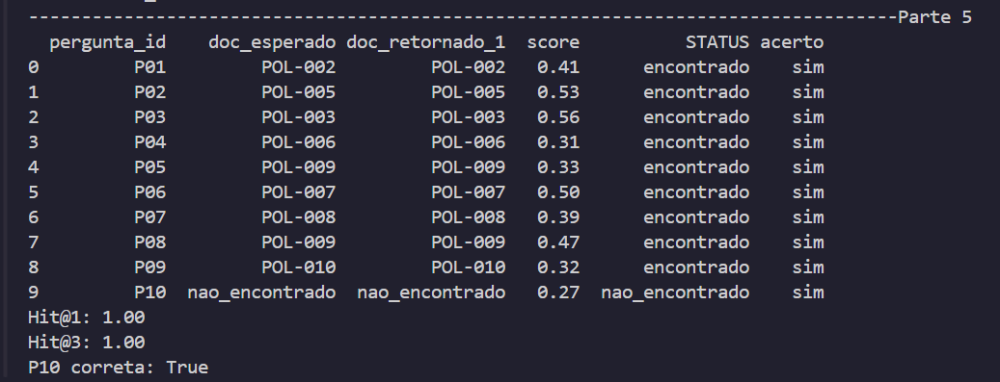

# Arquivo de Registro de Evidências das Partes 0 a 5

---

## Evidências - PARTE 0



Na imagem acima  contém a evidencia da parte 0 contendo tabela com doc_id, status e número de palavras de cada documento:

| doc_id | status | num_palavras |
|--------|--------|--------------|
|POL-001 |vigente | 164          |
|POL-002 |vigente | 136          |
|POL-003 |vigente | 128          |
|POL-004 |revogada| 90           |
|POL-005 |vigente | 119          |
|POL-006 |vigente | 117          |
|POL-007 |vigente | 114          |
|POL-008 |vigente | 119          |
|POL-009 |vigente | 142          |
|POL-010 |vigente | 92           |
|POL-011 |vigente | 102          |
|FAQ-001 |vigente | 145          |

---

## Evidências - PARTE 1



Na imagem acima  contem a evidencia da parte 1, o número total de chunks, número de chunks por documento e um exemplo de chunk completo:

**Total**: 46 chunks

|doc_id|Número de chunks por documento|
|---|---|
|FAQ-001|6|
|POL-001|3|
|POL-002|4|
|POL-003|4|
|POL-004|3|
|POL-005|3|
|POL-006|4|
|POL-007|4|
|POL-008|4|
|POL-009|4|
|POL-010|3|
|POL-011|4|

Exemplo de chunk completo:

```text
{
  'doc_id': 'POL-001',
  'titulo': 'Política de Onboarding',
  'secao': 'Objetivo',
  'status': 'vigente',
  'texto': 'Esta política define as etapas dos primeiros 30 dias de um novo colaborador na Horizonte Tech.'
}
```

---

## Evidências - PARTE 2


**Forma da matriz**: (46, 350) — 46 chunks, vocabulário de 350 palavras únicas.

**Decisão de pré-processamento**: usei TfidfVectorizer(lowercase=True), sem remoção de acentos e sem remoção de stopwords.
**Motivo**: testei a recuperação nas perguntas do gabarito sem essas opções extras e obtive Hit@1 e Hit@3 de 100%, então não havia problema a corrigir que justificasse adicionar mais pré-processamento.

---

## Evidências - PARTE 3



Na imagem acima apresenta os top-3 chunks retornados para P01, P02 e P10:

**P01** — "Com quantos dias de antecedência devo solicitar minhas férias?"

|doc_id|secao|score|
|------|------|------|
|POL-002|Como solicitar|0.41|
|POL-002|Venda de dias|0.41|
|POL-002|Direito a férias|0.25|

**P02** — "Quantos dias por semana posso trabalhar de forma remota?"

|doc_id|secao|score|
|------|------|------|
|POL-005|Regra de trabalho remoto|0.53|
|FAQ-001|Posso trabalhar remoto todos os dias?|0.20|
|POL-008|Entrevista de saída|0.17|

**Confirmação**: a POL-004 (revogada) não aparece entre os resultados, conforme esperado pela regra de vigência.

**P10** — "Qual é a política de estacionamento da empresa?"

|doc_id|secao|score|
|------|------|------|
|POL-003|Auxílio para trabalho remoto|0.27|
|POL-008|Aviso|0.21|
|POL-001|Objetivo|0.18|

---

## Evidências - PARTE 4

**Threshold escolhido**: 0.29

**Justificativa**: ao rodar as 10 perguntas do gabarito, o menor score entre as perguntas com resposta válida foi 0.31 (P04) e o score da única pergunta sem resposta no corpus (P10) foi 0.27, uma margem de apenas 0.04. Escolhi 0.29, aproximadamente no meio desse intervalo, para dar segurança nos dois sentidos,  e não classificar P04 como "não encontrado" indevidamente, nem responder P10 com um trecho de política errado.



A imagem acima contem os resultados das 10 perguntas usando a função *buscar(pergunta, k=1)* que foi usada para decidir o threshold.



na imagem acima tem as duas saidas completas de P02 e P10.

Saída completa para **P02**:

```text
PERGUNTA: Quantos dias por semana posso trabalhar de forma remota?
RESPOSTA: O colaborador pode trabalhar de forma remota em até 3 dias por semana. Os dias presenciais obrigatórios são terça-feira e quinta-feira.
FONTE: POL-005 | Política de Trabalho Híbrido (versão 2) | Seção: Regra de trabalho remoto
SCORE: 0.53
STATUS: encontrado
```

Saída completa para **P10**:

```text
PERGUNTA: Qual é a política de estacionamento da empresa?
RESPOSTA: Não encontrei essa informação nas políticas vigentes. Procure a área de Pessoas e Cultura.
FONTE: nenhuma
SCORE: 0.27
STATUS: nao_encontrado
```

---

## Evidências - PARTE 5



Na imagem acima contém a tabela com pergunta_id, doc_esperado, doc_retornado_1, score, STATUS e acerto:

|pergunta_id|doc_esperado|doc_retornado_1|score|STATUS|acerto|
|-----------|------------|---------------|-----|------|------|
|P01|POL-002|POL-002|0.41|encontrado|sim|
|P02|POL-005|POL-005|0.53|encontrado|sim|
|P03|POL-003|POL-003|0.56|encontrado|sim|
|P04|POL-006|POL-006|0.31|encontrado|sim|
|P05|POL-009|POL-009|0.33|encontrado|sim|
|P06|POL-007|POL-007|0.50|encontrado|sim|
|P07|POL-008|POL-008|0.39|encontrado|sim|
|P08|POL-009|POL-009|0.47|encontrado|sim|
|P09|POL-010|POL-010|0.32|encontrado|sim|
|P10|nao_encontrado|nao_encontrado|0.27|nao_encontrado|sim|

Análise de erro: A pergunta que mais se aproximou do threshold foi a P04 "Qual é o prazo para enviar uma nota fiscal de reembolso?", com score 0.31, apenas 0.02 acima do limite de 0.29. Isso provavelmente acontece porque a pergunta usa termos mais genéricos como "prazo" e "enviar", que recebem peso IDF menor por aparecerem em mais de uma seção do corpus, reduzindo a distinção do vetor da pergunta. Se o threshold fosse ajustado para um valor pouco mais alto por exemplo, 0.32, essa pergunta passaria a ser classificada como "não encontrado". Uma correção possível seria testar a remoção de stopwords, o que poderia aumentar o peso relativo das palavras mais específicas da pergunta.

P10: STATUS devolvido foi nao_encontrado.

---
